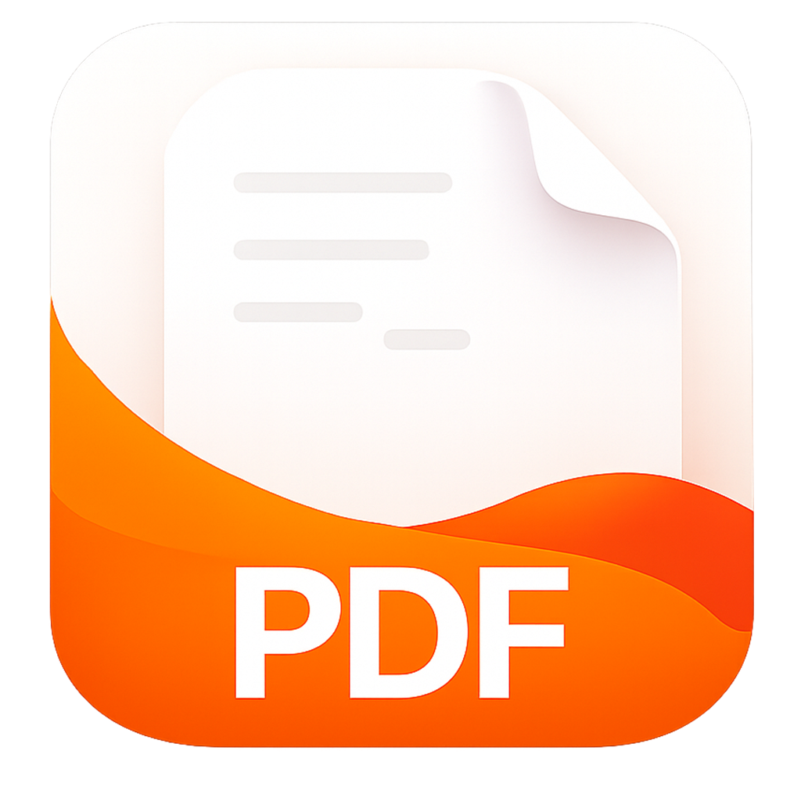

# 轻阅PDF

轻阅PDF 是一款轻量、安静的 PDF 阅读器。让用户没有打扰，专注阅读。



> 当前版本：2.3.9。项目仍在持续开发中，公开接口、配置格式和交互细节可能继续调整。

## 主要功能

- 多标签页阅读、标签页拖拽与独立窗口
- 连续阅读、单页等视图模式与平滑缩放
- 目录、缩略图、搜索结果和注释侧栏
- 文本选择、复制、浏览器搜索和外部划词工具支持
- 高亮、下划线、删除线、便签等 PDF 标注
- 多套浅色、深色与护眼主题，以及沉浸阅读模式
- 最近阅读、阅读进度和界面状态恢复
- 原生 Windows 安装、升级和卸载流程

## 系统要求

- Windows 10 或 Windows 11，x64
- 发布包无需单独安装 MuPDF

目前只提供 Windows x64 原生版本。

## 从源码构建

仓库不会提交完整的 MuPDF 源码树。首次构建前需要下载固定版本的 MuPDF：

```powershell
powershell -ExecutionPolicy Bypass -File .\scripts\fetch-mupdf.ps1
```

随后按 [构建指南](docs/BUILDING.md) 编译 MuPDF、`quietmupdf.dll`、主程序和安装器。

## 参与贡献

提交问题前请先搜索已有 Issue。代码贡献请阅读 [CONTRIBUTING.md](CONTRIBUTING.md)，安全问题请按 [SECURITY.md](SECURITY.md) 私下报告。首次发布仓库时可参考 [GitHub 发布准备](docs/GITHUB_PUBLISHING.md)。

## 许可证

轻阅PDF 按 [GNU Affero General Public License v3.0](LICENSE) 发布。你可以使用、研究、修改和再分发，但分发修改版本或通过网络提供修改版本时，需要遵守 AGPLv3 的源码公开等义务。

项目使用 MuPDF，并包含改编自 SumatraPDF 的 Windows 字体加载代码。完整来源和许可信息见 [THIRD_PARTY_NOTICES.md](THIRD_PARTY_NOTICES.md)。发布二进制文件前，请确认发布物附带或明确提供对应源码及许可证文本。

Copyright (C) 2026 轻阅PDF contributors.

轻阅PDF 不是 Artifex、MuPDF 或 SumatraPDF 的官方项目，也不受这些项目背书。
